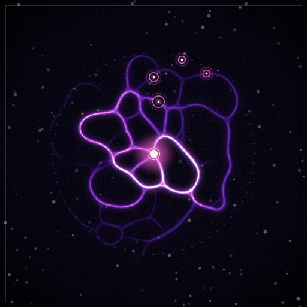

# Spores

**Living slime-mold NFTs whose agents trade on NEAR, and whose art is their trading history.**

Built for NEAR HACKATHON · Tracks: `nfts` (main), `security`, `agents`, `swarms` · NEAR testnet · MIT

**Live demo: [spores-five.vercel.app](https://spores-five.vercel.app)**. Nothing to install: [watch the recorded loop](https://spores-five.vercel.app/lab/loop?source=recorded&run=demo-20261106T101440Z&date=2026-11-06), then press **Check it against the chain**.

**Demo post on X: [x.com/Mafia__Interlet/status/2121131530462662693](https://x.com/Mafia__Interlet/status/2121131530462662693)**

| Epoch 2 | Age 16 | Age 57 |
| --- | --- | --- |
|  |  |  |
| Spore #0, on router2 | Spore #5, epoch 17, 4 tubes. `verify` regenerated this commit | Spore #6, epoch 58, 3 tubes, just after the hire in the recording |

## In one minute

Each spore is an NFT that owns an AI agent and that agent's money. Give a spore an agent and it starts buying and selling small services from other spores. Every settled payment thickens a tube between the two, the way the slime mold *Physarum polycephalum* thickens tubes that carry flow, and tubes with no traffic decay. The NFT's picture is that network, rendered from on-chain state, so the art changes as the spore lives. Its history also sets how much its agent may spend. Buying the NFT buys the agent, its balance and its history, and the old key stops working in the same transaction.

What you can check for yourself, with no keys:

- **It runs on NEAR testnet.** 64 spores across 63 epochs, with 214 payments settled (18.25 NEAR), 97 deliveries rejected, 187 purchases from an outside service, and 8 sales with royalty. The ledger reads `conserved: true`.
- **The art is reproducible.** One integer-only renderer gives identical bytes in Rust on macOS and Linux, in wasm and in an independent JS port. Your browser can replay all 63 epochs from public chain data and regenerate a committed image: `✓ Match · 63/63 epochs · image matches commit`.
- **The contract enforces the limits, not the agent.** Payments over the cap, over budget or to the wrong payee are refused on chain, with the reason in the receipt. The links are [below](#policy-security-model).
- **One math library everywhere.** The contract, the simulation, the verifier and the browser all run the same integer core (`spores-core`), pinned by shared test vectors.
- **The results are reported even where they disappoint.** Tubes buy a little reliability at a real price. A wash-trading attacker always loses money, but on a quiet network it can still buy reputation cheaply. Both are measured [below](#results).

The full design, with every number and its source: **[docs/how-it-works.md](docs/how-it-works.md)**.

## Watch it in two minutes

The quickest way is the [hosted recording](https://spores-five.vercel.app/lab/loop?source=recorded&run=demo-20261106T101440Z&date=2026-11-06). The same app runs locally with no keys, no testnet account and no gas. Requirements: Rust with the `wasm32-unknown-unknown` target (built with rustc 1.97), Node 23.6 or newer, `curl`, and `jq` for the RPC examples. These steps were run from a clean export of the repository on macOS and in a Linux container (Debian, rustc 1.97.0, Node 24).

```sh
bash scripts/build-wasm.sh   # the renderer and core as wasm, then their checks against the shared vectors
(cd viz && npm ci)
bash scripts/demo.sh --playback
```

You should see the app open on a recording of a real testnet run, badged `RECORDED`, with Spore #6 going through the whole loop in about 47 s:

- it wakes and hires #11 for 0.1715 NEAR;
- the tube to #11 goes from D 0 to 473,807;
- its reputation rises from 0.85 to 1.42, and what it may spend goes up;
- its picture redraws;
- it is sold to a buyer for 0.50 NEAR, and the old key is refused.

Then **Check it against the chain** opens Verify. Press **Run verification** and your browser replays all 63 epochs, ending on `✓ Match · 63/63 epochs · image matches commit` (95 s on the last try). That check reads testnet, so it says `! Unable` offline; everything else plays offline. The landing page tells the same story in about 32 s, then shows what the live collection is doing now.

## The problem

1. An agent that holds money needs an owner, and ownership has to be transferable without handing over keys by hand.
2. Agents that pick providers by price alone ignore track record, and track records usually live off-chain where nobody can check them.
3. Agents need hard spending limits, or one bad prompt can drain them.
4. Any reputation signal invites fake activity, so it has to be shown to resist it.
5. Generative NFT art is usually random and then frozen, so it records nothing.

Spores makes the NFT the agent's account and its history in one tradeable asset. Spending limits are enforced in the contract and grow only as a spore earns trust. Payment history becomes a verifiable, decaying signal that agents use and the art displays, and the cost of faking it is measured.

## How NEAR is used

| Feature | Use |
| --- | --- |
| NEP-171 NFTs | 64 spores, with `nft_transfer` and `nft_transfer_call` (1 yoctoNEAR), NEP-177 metadata and NEP-181 enumeration, on `near-contract-standards` 5.30. Every owner change clears the operator, sets the policy to paused with zero budget and refunds jobs in flight (`reset_control` in `router/src/nft.rs`). Balance, tubes and age stay with the spore |
| Dynamic on-chain metadata | Traits and a vector glyph are generated from chain state on every read. NEP-177 `media` is the glyph as a `data:image/svg+xml` URI with its `media_hash`, and `extra` holds seed, age, degree, reputation, transfers, sales, state hash and image commit. The hash of the Physarum render is committed on chain with `commit_image` after a close |
| Royalties | The router's own `buy` pays the seller and a 5% royalty in the same call (0.475 + 0.025 NEAR for a 0.5 NEAR sale on testnet). NEP-199 `nft_payout` reports the same split. Approvals (NEP-178) are off, so no outside marketplace can sell a spore around the royalty |
| Function-call access keys | Agents hold one key per spore on an operator account, bound to the router and limited to `post_job`, `quote`, `accept`, `deliver`, `settle`, `reject`, `timeout_job` and `pay_service`, with a 1 NEAR gas allowance. The protocol refuses any deposit from them, so they can never call `buy`, `deposit`, `withdraw` or `nft_transfer`. The keeper has its own key for `close_epoch`, `timeout_job` and `commit_image` |
| Contract events | Every state change emits an event. Each `epoch_closed` carries the whole epoch input, so history can be rebuilt from close receipts alone, and it is sized against NEAR's 16 KiB log limit |
| Native NEAR | Deposits, withdrawals, escrow, market sales and payments to an outside service |
| Sub-accounts | **Not used for spores.** A desk spike decided against them: the router would have to control them anyway, so custody risk doesn't shrink, and `buy` would stop being atomic ([why](docs/how-it-works.md#why-one-ledger-not-an-account-per-spore)). Money sits in the router's ledger, keyed by spore id |

## How it works

1. **Mint.** All 64 spores are minted at genesis. Each spore's seed sets its colour and starting pattern, and dormant spores render as faint marks.
2. **Activate.** The owner activates a spore with a deposit, sets its policy and registers an operator account for the agent.
3. **Hire.** A consumer posts a job and providers quote. The consumer scores quotes as `quote / (1 + w*D_norm)`, with `w = 4` and `D_norm` the tube to that provider divided by the strongest candidate's tube, and accepts the lowest score. The payment moves into escrow.
4. **Deliver and settle.** The provider delivers a result hash and the consumer settles or rejects.
    - Settling takes a 1% fee and credits the provider, and only settled jobs count as flow.
    - Rejecting refunds the consumer and halves the tube.
    - At the deadline an undelivered job refunds, and a delivered one auto-settles with no flow.
5. **Grow.** At each epoch close, every tube's conductivity updates in integer math. Weak tubes are pruned, and the tube list is hashed into a fingerprint chained to the last one:

    ```
    D' = D - D*decay + gain * q/(q+K) * min(breadth, 4)/4
    ```

    Here `q` is the settled flow, and breadth counts the distinct partners of the less connected end. Spores get back a capped rebate from the fee pool, and the rest goes to the treasury.
6. **Allowance.** A spore's reputation `R = Σ isqrt(D)` sets its spending ceiling: `min(owner budget, base + gain * R)`. Neglected spores lose it as their tubes decay.
7. **Trade.** `list`, `buy` and `delist` run on the router. A buy moves the NFT, pays the seller and pays the royalty in one call. Control resets as above, and balance, connections and age stay with the spore.

The rules, parameters and the tests that pin them are in [docs/how-it-works.md](docs/how-it-works.md#2-one-integer-core).

## The art

Each image is a slime-mold render: a glowing organic network on a dark background, grown by a Physarum simulation seeded by the token and fed by its state, in one of five palettes chosen from the seed.

- Neighbours sit at fixed places on the collection ring, and nearer the centre when their tube is stronger.
- Tubes that carry more flow render brighter, and a nucleus and a ring mark each trading partner.
- A young spore is a thin, unfinished network; a mature one is branched and looping.

A contract can't run the simulation, so the art has two layers. The contract stores each spore's state hash and a committed image hash, and generates a small vector glyph into its metadata. The renderer is deterministic fixed-point code, so anyone can regenerate an image from state and compare its hash. The contract guarantees the state; the image hash is committed by this project's renderer and anyone can check it. Traits are computed from state (degree, age, reputation, transfers, sales), not rolled.

**Reproducibility.** The same 10 test cases give identical bytes in native Rust on arm64 macOS, on x86_64 macOS under Rosetta and on arm64 Linux in a container, in wasm under Node, and in an independent JS port; Chrome matched a committed image. **Not yet tested:** a second physical machine, Windows, Firefox and Safari. Nothing uses floats, libm or platform sort order, but that is a reason to expect a match, not a check. The image isn't injective in state (`D` is quantised to `D/1000`), so the state hash stays the authority.

## Policy (security model)

The spore's owner sets these, and the router contract enforces them, not agent code:

- a budget per epoch, capped by the living allowance;
- an allowlist of counterparties;
- a per-payment cap;
- an owner-only `pause`;
- operators hold restricted function-call keys, never full-access keys.

The contract refused each of these on testnet, with the reason in the receipt:

- [per-payment cap](https://testnet.nearblocks.io/txns/E3s92QQjYYsSX28dPthr7w6Vs55tMLF9y2pTbGPrGHVb)
- [epoch budget](https://testnet.nearblocks.io/txns/Fat7jVV746jBCoCdLwLCRsnuYKvuwNTJFfZmQgnk3fDm)
- [payee not on the allowlist](https://testnet.nearblocks.io/txns/918spGjviPnB8UHEeBbVrCoXYdVCS3urTH6amiedju4B)
- [old operator after a sale](https://testnet.nearblocks.io/txns/DY9sTYpeWz6Szy82nMkZRjBnE6SHtwKmErzrhQSvJcz6)
- [old owner after a sale](https://testnet.nearblocks.io/txns/6qbJKSMdTXz23U1QAFzgXaGC51v6Usr8QAUGn28q869x)

A scripted run of every contract rule passed 83 of 83 steps ([the transactions](docs/how-it-works.md#82-contract-on-testnet-83-of-83-router2-2026-10-31)).

Known limits:

- **One contract holds all the funds.** Every spore's money sits in the router's ledger, so a router bug puts all of it at risk. There has been no outside audit.
- **The router can be redeployed.** Whoever holds its account's full-access key can change the code, and this was done during the build. The admin also commits images, withdraws the treasury and raises `max_active`.
- **A stolen owner key loses the spore.** Policy limits the agent, not the owner.
- **A leaked operator key can still spend inside the policy,** up to the cap and budget, on allowed payees, until the owner pauses the spore. An allowlisted payee is trusted to deliver.
- **A sale doesn't delete the old key.** The router can't remove keys from another account, so the key is refused because its account is no longer the operator. If a new owner registers that same account again, the key works again.
- **A committed image isn't checked by the contract.** `commit_image` is admin only, and `verify` is what catches a wrong hash.
- **An owner of many spores can hold trading-pair slots** with jobs it never delivers (4 per spore, refunded at the timeout), up to `MAX_EPOCH_PAIRS`.
- **Seeds use the block's random seed,** which a block producer can predict. No money depends on it.

## Verify it yourself

```sh
cargo run --release -p spores-verify -- epochs --router spores-hack-router4.testnet --closes docs/router4-closes.txt
cargo run --release -p spores-verify -- image  --router spores-hack-router4.testnet --closes docs/router4-closes.txt --spore 6
```

No keys are needed. In a clean Linux container this took about 2 minutes and printed:

- one `epoch N: <fingerprint> match` line per epoch;
- `verified 63 epochs on spores-hack-router4.testnet: match`;
- `spore 6: age 63, 1 tubes, renderer v1`, then `image: match`.

`epochs` reads each epoch's `epoch_closed` event from its close transaction (payments, rejections, fee pool and active set). It reruns the update rule with the router's own parameters, rebuilds the canonical string and compares its sha256 with the fingerprint in the event and the one stored on chain. `image` rebuilds a spore's state at the epoch of its committed image, checks the committed state hash, renders the image and compares the image hash. Old transactions are only on rate-limited archival RPC, so a late replay can be slow; if the archival nodes stop answering, `verify` stops with an error naming each endpoint.

Read any transaction or the live state by RPC, with no browser or keys (the explorer may show automated clients a bot check):

```sh
curl -s https://archival-rpc.testnet.fastnear.com -H 'content-type: application/json' -d '{"jsonrpc":"2.0","id":1,"method":"tx","params":{"tx_hash":"DY9sTYpeWz6Szy82nMkZRjBnE6SHtwKmErzrhQSvJcz6","sender_account_id":"operator.spores-hack.testnet","wait_until":"FINAL"}}' | jq -r '.result.status'
bash scripts/view.sh spores-hack-router4.testnet nft_token '{"token_id":"6"}'      # owner, glyph, traits, image commit
bash scripts/view.sh spores-hack-router4.testnet spore_summary '{"spore_id":6}'    # policy, balance, reputation, allowance
bash scripts/view.sh spores-hack-router4.testnet ledger_totals '{}'
```

You should see:

- the first command print a `Failure` carrying the refusal;
- `nft_token` show `buyer.spores-hack.testnet` as Spore #6's owner;
- `ledger_totals` end in `"conserved": true`.

### Tests

```sh
export PATH="$HOME/.cargo/bin:$PATH"
cargo test --workspace               # 106 tests: core, sim, renderer, router (mocked runtime), shared vectors
(cd viz && npm test)                 # 484 tests; needs scripts/build-wasm.sh first
(cd agents && npm ci && npm test)    # 77 tests: the TypeScript rules against the Rust vectors, client, scenes
(cd outside && npm test)             # 5 tests
```

## Run it for real

This spends testnet gas, closes real epochs and **really sells one spore**, which stays with the buyer. It takes about 12 minutes. It signs as the router's owner and operators, so it needs their keys in a git-ignored `.env`, which is not in this repository. Without the keys, watch the recording and check it with `spores-verify` as above.

```sh
bash scripts/phase6-setup.sh   # with those keys: funds and registers what the run needs; safe to run again
bash scripts/demo.sh
```

The terminal prints each stage with what to look for, and the browser follows along at `/lab/loop`. The recorded run printed:

```
00:06 ✓ Wake      12 agents started. Spore #6 is the one to watch
00:12 ✓ Close     epoch 55 closed
01:18 ✓ Hire      #6 hired #11 at 0.171 NEAR from 1 quote
01:18 ✓ Settle    #6 paid #11 0.171 NEAR
01:34 ✓ Grow      tube #6–#11: D 0 → 473,807
01:34 ✓ Reputation R 0.85 → 1.42, may spend 0.270 NEAR → 0.384 NEAR an epoch
01:34 ✓ Art       redrawn from 3 tubes at age 57
03:09 ✓ Sell      #6 sold to buyer.spores-hack.testnet for 0.500 NEAR
04:21 ✓ Control   old key refused (caller is not this spore's operator); the buyer's agent sent pay_service
11:43 ✓ Closes    9 closes
11:43 ✓ Report    14 of 14 checks passed
spores-verify epochs: verified 63 epochs on spores-hack-router4.testnet: match
spores-verify image --spore 6: image: match
```

### The Demo Lab

With the same keys, `node agents/src/scene-server.ts` serves the Demo Lab's scenes at `/lab`; it answers only pages on the same machine. Both story scenes also play from their recordings without keys.

- **Rogue agent** (`/lab/rogue`). The owner narrows a spore's policy, then three payments are refused by the contract (with their failed receipts) and one is allowed. Its tubes then decay over two real closes.
- **Sale** (`/lab/sale`). The NFT moves to a second account, the seller and the royalty are paid, and the old operator's next payment is refused. Balance, tubes and age are unchanged. It really sells a spore.
- **Wash trading** (`/lab/wash`). A simulation panel, labelled as one, built from `cargo run --release -p spores-sim -- wash`. It opens on the case the defence loses.
- **Prompt injection** is **not implemented**: no LLM agent exists in this project, and the Demo Lab card says so.

## Results

### Does the slime mold help?

The same economy ran under identical seeds and disruptions in two modes: price only, and price with connections. Simulated providers have hidden quality, and consumers reject bad results. From `cargo run --release -p spores-sim -- all`:

- 20 seeds, 60 epochs, 16 active spores, 3 jobs per consumer per epoch;
- the best-value provider is killed at epoch 20, the strongest tube cut at 30, and the runner-up's cost tripled at 40.

| Metric | Price only | Price with tubes (shipped) |
| --- | --- | --- |
| Average price paid (NEAR) | 0.0948 | 0.1211 |
| Failed attempts | 28.2% | 25.3% |
| Unfulfilled jobs | 7.6% | 7.1% |
| Quality of hired providers | 0.717 | 0.746 |
| Epochs to recover: provider killed | 1.0 | 1.4 |
| Epochs to recover: tube cut | 0.5 | 0.7 |
| Epochs to recover: cost tripled | 1.6 | 1.8 |

**Tubes buy a small gain in reliability at a real price.** Failed attempts fall about 10% in relative terms while the average price rises 28%, and recovery after a shock is not faster. With the parameters SPEC first proposed, tubes don't beat price only, so the shipped rule is the result of tuning. On testnet, tubes changed the winner in 9 of 26 contested hires; two of the three examples examined were then rejected for a wrong answer, because a tube records history and doesn't guarantee quality. [All seven variants](docs/how-it-works.md#91-does-the-slime-mold-help).

### Wash trading

**Receipts and escrow don't stop an attacker who controls both sides of a trade.** The defence is economic: a fee, a saturating gain, breadth damping, a capped fee rebate and a concave reputation. The aim is to make faked history cost money, and it doesn't always stop it.

The gate has two conditions: the attacker loses money, **and** its best spore stays below the honest median reputation. The sweep covers 270 cases:

- 2 or 3 attacker spores (1 is refused as a self-payment);
- fee 50, 100 or 200 bps, and K and gain from ½× to 2×;
- loops of 0.01–5 NEAR per edge per epoch;
- 3 seeds each, with the worst counted.

With the living allowance the router enforces:

| Honest jobs per spore per epoch | 16 active | 64 active |
| --- | --- | --- |
| 3 | 270/270 | 270/270 |
| 1 (what the testnet agents do) | 255/270 | **168/270** |

- **The attacker loses money in all 270 cases, in every configuration.** The capped rebate makes this provable, and tests pin it. The smallest loss found is 0.001 NEAR.
- **The reputation half fails at low traffic, and that is the live setting.** At 64 active with 1 job, a 3-spore loop of at least 0.2 NEAR per edge per epoch passes the honest median while losing about 0.2 NEAR over 40 epochs. So on a quiet network, faked reputation can be bought cheaply. `/lab/wash` opens on this case.
- **Without the allowance,** `sim all --max-active 64` gives 261/270 and exits 1. At 16 active it gives 270/270.
- **Tiny loops gain more reputation per NEAR than honest spores**, though they stay at or below 0.39 of the honest median. **Outside the K range** 6 of 361 cases fail, and the sweep **doesn't model** an attacker who also buys real services to raise its breadth. [Details](docs/how-it-works.md#92-wash-trading).

### On chain

All on `spores-hack-router4.testnet` (the evidence router; the live one is router5), epochs 1 to 63. `node scripts/chain-stats.mjs` reproduces the chain figures from public RPC, with no keys.

| Stat | Value |
| --- | --- |
| Settled volume | 18.2523 NEAR over 214 consumer-settled payments, in 205 pair-epochs |
| Rejected deliveries | 97 (chain and run logs agree) |
| Outside-service purchases | 187, 1.87 NEAR (run logs and `ledger_totals` agree) |
| Sales with royalty | 8 |
| Ledger | `conserved: true` |
| Inclusion to finality | 2.45 s average for closes |
| `close_epoch` gas | 6.07 Tgas at 9 active, 20.66 Tgas at 64 active |
| `buy`, with both payouts | 12.52 Tgas |
| Living allowance | bound 11 of 30 hires in the recorded run |

[Every method's gas, and how each figure was read](docs/how-it-works.md#86-chain-stats-and-gas-router4-epochs-163).

## Deployed (testnet)

| Account | Role |
| --- | --- |
| [`spores-hack-router5.testnet`](https://testnet.nearblocks.io/address/spores-hack-router5.testnet) | **The live router** (fresh account, created 2026-11-13; the hosted app's LIVE view reads it). 64 spores, all active, same wasm as router4 but 150 s epochs (router4: 30 s); its state was wiped and set up again the same day, so it restarted at epoch 1 with an empty graph. Its history isn't in any figure on this page |
| [`spores-hack-router4.testnet`](https://testnet.nearblocks.io/address/spores-hack-router4.testnet) | **The evidence router.** Every figure, recording and `verify` run on this page is from it: 64 spores, epochs 1 to 63. Wasm sha256 `b82f4dcd37484fca2b58638aff7d1b939baf882891b2dedb31084de84db2f1c5`, which this tree rebuilds to and the on-chain code hash matches. Its trading graph was left empty on 2026-11-12, when an unattended run lost its `outside` service and the keeper went on closing idle epochs (each close decays every edge by 25%); the committed recordings and its close list are unaffected |
| `router3.spores-hack.testnet`, `spores-hack-router2.testnet`, `spores-hack-router.testnet` | Earlier routers, kept as evidence for the earlier runs (one abandoned) |
| `deployer.spores-hack.testnet` | Admin, keeper and royalty account |
| `owner.spores-hack.testnet`, `buyer.spores-hack.testnet` | Seller and buyer in the sales. We control both, so no sale here is a market price |
| `operator.spores-hack.testnet`, `operator2.spores-hack.testnet` | Agent accounts, one function-call key per spore |
| `outside.spores-hack.testnet` | Payee of our own paid data service |

Spore #6's story, from the recording:

| Step | Transaction | Result |
| --- | --- | --- |
| Post job | [`FPQEfxZi…`](https://testnet.nearblocks.io/txns/FPQEfxZi6afpPPgxZ38sRaMmGNdPzyMnwxkCZJQmSmfU) | Success |
| Hire #11 | [`44wpNL7U…`](https://testnet.nearblocks.io/txns/44wpNL7UDjFfJNfHaZ2jvM2wVSMz4rNEZmGB7xmYk6Q5) | Success |
| Settle | [`22f1zQn7…`](https://testnet.nearblocks.io/txns/22f1zQn7W1qCzpytfz9UqkKPZXRvmz4jAS7qKD2PmFd5) | Success |
| List | [`CAfDTKon…`](https://testnet.nearblocks.io/txns/CAfDTKonvZQD8MnbjwDw1mGYxHGDcKgpqHadBQR7CFpM) | Success |
| Buy, with seller and royalty paid | [`HZNJeWxy…`](https://testnet.nearblocks.io/txns/HZNJeWxy19uDQam1kmWcJ2dsd6zL4HzWN7H6tVj3sSh3) | Success |
| Old operator tries `post_job` | [`DY9sTYpe…`](https://testnet.nearblocks.io/txns/DY9sTYpeWz6Szy82nMkZRjBnE6SHtwKmErzrhQSvJcz6) | Refused: `caller is not this spore's operator` |
| Old owner tries `withdraw` | [`6qbJKSMd…`](https://testnet.nearblocks.io/txns/6qbJKSMdTXz23U1QAFzgXaGC51v6Usr8QAUGn28q869x) | Refused: `only the spore owner can do this` |

## Status

| Item | State |
| --- | --- |
| Graph model, reputation and fingerprint | Built. `spores-core` is the one implementation: the router, `sim`, `verify` and the browser all run it, checked against shared vectors |
| Router, ledger and policy | Built and run on testnet: 64 spores active, refusals seen in real receipts |
| Spore NFT and transfer semantics | Built and run on testnet: NEP-171 and NEP-199; a transfer clears the operator, pauses the policy and keeps balance, tubes and age |
| Fixed-point renderer, image commits, glyph and gallery | Built. Rust, wasm and the JS port match the shared vectors on macOS and Linux; a second physical machine has not run the check yet |
| Market and royalties | Built and run on testnet: list, buy with royalty, old operator locked out, new owner takes over |
| Agents, job escrow and outside service | Built and run on testnet: rule-based hiring, replayed against `spores-core` from the log. No LLM agent exists |
| Living allowance | Built and enforced on every payment. In the recorded run 11 of 30 hires were skipped because the quote was above what the spore may spend. The agent skips the hire after reading that limit, so those aren't contract refusals; router tests cover the contract's own check |
| App | Built and hosted at [spores-five.vercel.app](https://spores-five.vercel.app): landing page, gallery, network, spore page with wallet actions, activity, browser verify, Demo Lab. On the hosted copy the recording played to 14 of 14 checks and Verify reached `✓ Match · 63/63 epochs · image matches commit`. No wallet transaction has been signed from it yet |
| Baseline and wash-trading results | Run and reported above, the unfavourable ones included |

## Disclosure

Spores is a solo project, and its author has no other project in this hackathon (Q-015).

**No baseline.** All of the work in this repository was done inside the organizers' window, which opened with the 2026-10-19 announcement (Q-001). There is no pre-hackathon code, so there is no `pre-hackathon` tag (Q-003).

The git history starts on 2026-11-02, when the work so far was first committed, so commit dates don't separate the stages. From the project's own notes, all of them after 2026-10-19:

- `slime.py` and `slime_example.png`: the first prototype of the art renderer, kept for reference. `renderer/` is an integer-only port of it, with a similar look and no shared code.
- A browser sketch of the pixel-based visualization (`slime-router.html`), made on 2026-10-26. It is not in this repository, and `viz/` reuses none of it.
- The graph core and simulation (`core/`, `sim/`, `vectors/`), 2026-10-29.
- The renderer, router contract and testnet scripts (`renderer/`, `router/`, `scripts/`), 2026-10-31.
- Agents, outside service, market, living allowance and `verify`, 2026-11-02.
- The app, scenes, one-command demo and 64 active spores, 2026-11-03 to 2026-11-07.

## Libraries and AI-generated code

Code in this repository was written with Claude Code (AI-generated) and reviewed by the author. Every library below is third-party; none is the author's own.

| Where | Library | Version |
| --- | --- | --- |
| `router/` | `near-sdk`, `near-contract-standards` | 5.30.0 |
| `core/`, `renderer/` | `sha2` | 0.10.9 |
| `sim/`, `verify/`, `core-wasm/`, `renderer/` CLI | `serde_json` | 1.0.154 |
| `agents/` | `near-api-js` | 7.4.0 |
| `viz/` | `react`, `react-dom` | 19.3.1 |
| `viz/` | `react-router` | 8.5.1 |
| `viz/` | `@hot-labs/near-connect` | 0.12.0 |
| `viz/`, development only | `vite` 8.3.5, `vitest` 5.1.0, `typescript` 7.0.2, `@vitejs/plugin-react` 6.2.1, `@testing-library/react` 16.3.3, `jsdom` 30.1.3, `fake-indexeddb` 6.2.7 | |
| `viz/public/fonts/` | Gluten, Shantell Sans, Geist Mono, Instrument Serif, each under the SIL Open Font License with its file alongside | |

`Cargo.lock` and each `package-lock.json` have the full trees. `outside/` has no dependencies. Tools: `cargo-near` 0.22.0, `near-cli-rs` 0.30.1, `twiggy` 0.8.0; `brand/build.sh` also uses `fonttools`, `brotli` and `uharfbuzz`.

## Limitations

- **Testnet only.** Nothing is deployed on mainnet.
- **The economy is ours.** We run all the agents, the buyer, the seller and the outside service. No sale reflects a market price, and no outside party has traded.
- **Agents are rule-based, and no LLM runs.** "Work" is rule-generated, with hidden quality rolled from a seed. There is no injection scene, and the rogue agent is a script.
- **Real runs need our keys.** Without them you can watch the recording and check it against the chain. Each real `demo.sh` run sells one spore for good (spores 1–6 are with the buyer so far). Of five real runs, two failed a check, and one more passed with no settled hire before its sale.
- **Tubes are not a clear win** in the sim, and wash resistance is weak at live traffic: see [Results](#results).
- **Throughput is low.** Each consumer has one job in flight, a job cycle outlasts a 30 s epoch, and public RPCs rate-limit, so most epochs have few trading pairs. Closes have named 0–31 pairs, against a designed limit of 224.
- **Agent results travel by shared directory,** with only their hash on chain, which ties all agents to one machine.
- **No migration path.** New contract state means a new account.
- **`verify` needs every close since epoch 1,** and old transactions are only on rate-limited archival nodes.
- **Not tried:** signing from the app with a real wallet, other marketplaces (approvals are off, so they can't sell a spore), and how wallets show the glyph. Nobody but the author has watched the demo.

## Repository layout

```
core/        spores-core: pure integer graph, fees, hiring, reputation, epoch close, glyph; no chain dependency
core-wasm/   spores_core for the browser (wasm32 C ABI)
sim/         economy simulation: baseline, wash sweep, allowance, decision replay
renderer/    fixed-point Physarum renderer: Rust, wasm ABI and an independent JS port
router/      the NEAR contract: NFTs, ledger, policy, jobs, epoch close, market, image commits
verify/      CLI that replays fingerprints and regenerates images from chain data
agents/      TypeScript agents, keeper, run harness and scenes
outside/     our paid data service, sold only against an on-chain receipt
viz/         the web app (Vite, React, TypeScript), with committed recordings in public/recorded/
vectors/     shared test vectors that every implementation must match byte for byte
scripts/     setup, exit runs, wasm build, demo.sh, chain-stats.mjs, view.sh
brand/       mark, wordmark, icons and social card
docs/        how-it-works.md (design as built, and the evidence), verify-notes.md (NEAR docs checks),
             close lists for verify, sample images
SPEC.md      the design as first written
slime.py     the prototype renderer (see Disclosure)
```

## License

MIT: see [LICENSE](LICENSE). The fonts in `viz/public/fonts/` keep their own SIL Open Font License files.
