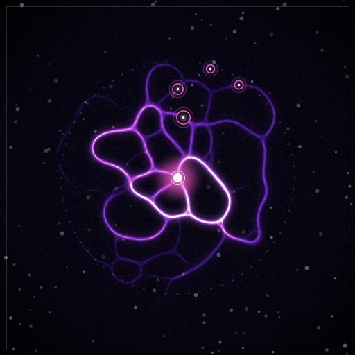

# Phase 5: epochs, allowance, market

Status on 2026-11-02. Every Phase 5 item in ROADMAP is built. The exit run passed on testnet: 14 of 14 checks on `spores-hack-router4.testnet` (`out/agents/phase5-exit2/report.md`, copied to `out/phase5/`). The first exit run (`phase5-exit1`) failed the sale; its cause and the fix are below.

| Exit criterion (ROADMAP) | Result | Evidence |
| --- | --- | --- |
| Sale: royalty paid | Spore 5 sold by the owner to the buyer for 0.5 NEAR. The seller got 0.475 NEAR and the royalty account (the admin, `deployer.spores-hack.testnet`) 0.025 NEAR, 500 bps. Both transfer receipts succeeded | list `3x73GvfiX8v77Hgk7jYpUZaYRiW117aqhmM6x6gwrFnM`, buy `BJUXhpDuHRv5dcfNA7uWQhFLJ6mamxzpeVYRAaoTHjsS` |
| Old operator key fails | `post_job` with the spore's old function-call key: "caller is not this spore's operator". The old owner's `withdraw`: "only the spore owner can do this" | `EhbGawHaoT2bDykHYSu4Qy9Z6Q8naecTkui9B4YreFiv`, `6cLHttRhTw95sa1BBYFNdcjn6ZLGsPp3KfzDbCdcenoq` |
| New policy starts paused | Read at the block before and the block that ran the buy: operator `operator.spores-hack.testnet` → none, `operator_gen` 1 → 2, policy → paused, zero budget, empty allowlists; listing cleared, `sales` 1 | report, "Before/after" |
| Balance, tubes, age intact | Balance 0.272650759 NEAR, tubes `0:401765, 1:917128, 3:444135, 4:92567, 6:822979`, age 11, reputation 3467, all identical before and after. No job of the spore was in flight, so no escrow came back | same |
| New owner re-registers an operator and the agent resumes | The buyer registered `operator2.spores-hack.testnet` and set a policy. The agent restarted under operator2 and sent 40 transactions for the rest of the run | `EM7jhdQsViofVu1Gx1YTnnLtZDCAoy4bCFURhjS9npxj`, `7RpEiSYKrEQ7ynBQ9WvEqZrN61A3GLC4eJnNNJ6GX9Ta`, `agent-5-operator2.log` |
| `verify` reproduces fingerprints | `spores-verify epochs` replayed all 16 closes of router4 (both exit runs) from the close receipts alone: 16 of 16 match the event, the stored `fingerprint(epoch)` and the chain head | report, verify block |
| `verify` regenerates the sold spore's image | `spores-verify image --spore 5`: the state hash and image hash committed for epoch 17 match the state rebuilt from the replayed tubes and the image re-rendered from it | `d09c9957…` state, `ac15a3e9…` image |

The six Phase 4 checks also pass in the same run (unattended trading, tubes, art changes, 95 of 95 hires replay, ledger conserved, outside service), plus 72 of 72 image commits.

Router: `spores-hack-router4.testnet`, admin `deployer.spores-hack.testnet`, wasm sha256 `640c093f600c806425f2205958dba444f610a251dc19266148ea07641c1b130b` (501,054 bytes, `non-reproducible-wasm`; this tree rebuilds to the same hash). Storage after setup: 540,256 bytes, 5.40 NEAR. Explorer: `https://testnet.nearblocks.io/txns/<hash>`.



Its on-chain glyph is `img/phase5-spore5-glyph.svg` (the `glyph` view, 983 characters).

## Reproduce

```sh
export PATH="$HOME/.cargo/bin:$PATH"
cargo test --workspace && cargo clippy --workspace --all-targets
cargo run --release -p spores-sim -- allowance       # living-allowance candidates and the wash gate
(cd agents && npm ci && npm test) && (cd outside && npm test)
bash scripts/phase5-setup.sh          # idempotent; REDEPLOY=1 deploys new code over the same state
bash scripts/phase5-testnet.sh        # about 15 min; writes out/agents/<run>/ and out/phase5/
cargo run --release -p spores-verify -- epochs --router spores-hack-router4.testnet --closes docs/phase5-closes.txt
cargo run --release -p spores-verify -- image  --router spores-hack-router4.testnet --closes docs/phase5-closes.txt --spore 5
```

`.env` needs the Phase 0 role keys and `ROUTER_V0_*`. Setup appends `PHASE5_ROUTER_ACCOUNT_ID`, `PHASE5_ROUTER_PRIVATE_KEY`, `OPERATOR2_ACCOUNT_ID`, `OPERATOR2_PRIVATE_KEY`, `P5_SPORE_<0..8>_FC_PRIVATE_KEY`, `P5_KEEPER_FC_PRIVATE_KEY` and `P5_OPERATOR2_FC_PRIVATE_KEY`. Keys are written, never printed.

## What was built

- **`spores-core`.**
  - `state.rs`: the per-spore state hash, `sha256("spores/state/v1|id|epoch|seed|age|neighbor:D|...")`.
  - `glyph.rs`: the integer-only SVG glyph. The 64 ring slots use a 17-entry Q16 sine table; a renderer test checks it against `sin_table()`. The output has no `#`, `%` or `"`, so it can sit in a `data:` URI and in JSON unescaped.
  - `market::royalty_split`: the royalty is rounded down, so seller plus royalty always equals the price.
  - `allowance::Allowance` with the shipped values.
  - `vectors/core.json` gained `royalty_split`, `allowance` and `spore_state` (state canonical string, hash and glyph). Regenerating it changed only those three keys; `vectors/agents.json` is unchanged.
- **`spores-sim allowance`.** Runs the baseline and the in-range wash gate under six allowance candidates and writes `allowance.json` and `allowance.md`. `spores-sim all` still writes byte-identical Phase 1 outputs: the allowance is off unless set.
- **Router.**
  - `list`, `delist`, `buy` and `listings` (`market.rs`). A listing blocks `withdraw` and `pause`; any transfer drops it.
  - NEP-199 `nft_payout` and `nft_transfer_payout`.
  - `commit_image`, `image_commit` and `glyph` (`art.rs`).
  - `withdraw_treasury`.
  - The living allowance in `check_limits`, which covers `accept` and `pay_service`; `spore_summary` gains `effective_budget`.
  - The state hash stored at each close.
  - The extended `epoch_closed` event.
  - NEP-177 `media` is the glyph as a `data:image/svg+xml;utf8,` URI, with `media_hash`. `extra` gains `sales`, `listed_price`, `state_hash` and the image commit.
  - `Config` gains `base_budget`, `trust_gain`, `royalty_bps` and `royalty_account`, with serde defaults, so the Phase 4 init JSON still parses.
  - Tests: 29, 9 of them new. The random ledger walk now also lists, buys back and forth, withdraws the treasury, and fails payouts and treasury transfers. One test builds the worst-case event for the log limit.
- **`spores-verify`** (new crate, Rust, `curl` for RPC, no new dependencies).
  - `epochs` replays every close from its `epoch_closed` event with `spores_core::close_epoch` under the router's `config`.
  - `image` rebuilds a spore's state at its commit epoch, checks the state hash, renders it and compares the image hash.
  - RPC order: FastNEAR, dRPC, then the archival node. 3 tests.
- **Agents.**
  - The keeper renders every active spore after each close and calls `commit_image`.
  - Snapshots gain the owner, operator, policy, allowance, listing and commit fields.
  - `agent.ts` takes an operator override (`AGENT_OPERATOR_ACCOUNT_ID`, `AGENT_FC_PRIVATE_KEY`) and a `KEY_PREFIX`, and checks `budget_left` before `accept`.
  - `setup.ts` has `SETUP_PHASE=5`: faucet router, v0 top-up, operator2, `commit_image` on the keeper key, and code-only `REDEPLOY=1`.
  - `run.ts` gains `sale@N`, image-commit and verify checks, and block-precise before and after reads.
  - `near.ts` gains `view(.., blockId)` and `txStatus`.
- **Scripts.** `scripts/phase5-setup.sh` and `scripts/phase5-testnet.sh`.

## Living allowance in sim

`spores-sim allowance` (20 seeds × 60 epochs, shipped params and hiring, owner budget unlimited so the ceiling binds):

| base (NEAR) | trust_gain (NEAR per R 1000) | Avg price paid | Failed attempts | Unfulfilled jobs | Budget-blocked hires | Hired quality | Wash gate in range | Worst attacker net (NEAR) |
| --- | --- | --- | --- | --- | --- | --- | --- | --- |
| none | none | 0.1211 | 25.3% | 7.1% | 0.0% | 0.746 | 270/270 | -0.0010 |
| 0.050 | 0.100 | 0.1134 | 25.9% | 26.9% | 21.3% | 0.740 | 0/270 | -0.0010 |
| 0.100 | 0.100 | 0.1194 | 25.2% | 11.4% | 4.7% | 0.745 | 270/270 | -0.0010 |
| 0.050 | 0.200 | 0.1165 | 25.5% | 20.9% | 14.8% | 0.744 | 0/270 | -0.0010 |
| 0.100 (shipped) | 0.200 | 0.1211 | 25.3% | 8.6% | 1.6% | 0.746 | 270/270 | -0.0010 |
| 0.200 | 0.200 | 0.1215 | 25.3% | 7.5% | 0.4% | 0.745 | 270/270 | -0.0010 |

The unfavourable result: a tight allowance (base 0.05 NEAR) fails the wash gate 0/270, although the attacker still loses money in every case. The failing half is the reputation criterion. A low base starves the honest spores, which cannot afford their hires, so their tubes and median reputation fall. The attackers keep trading under the cap by splitting their volume. The shipped values (0.1 NEAR plus 0.2 NEAR per 1000 reputation) block 1.6% of hires, raise unfulfilled jobs from 7.1% to 8.6%, leave the average price unchanged and keep the gate at 270/270.

## Gas on testnet

From the exit run (9 active spores; successful calls, Tgas):

| Method | Calls | Avg | Max |
| --- | --- | --- | --- |
| close_epoch (extended event, 9 state hashes) | 8 | 6.26 | 6.35 |
| commit_image | 72 | 2.79 | 2.82 |
| list | 1 | 2.80 | 2.80 |
| buy (with both payout callbacks) | 1 | 11.97 | 11.97 |
| register_operator | 1 | 2.80 | 2.80 |
| set_policy | 1 | 2.88 | 2.88 |

`close_epoch` was 4.01 Tgas on average in Phase 4 at the same 9 active spores.

Views called as transactions (near-sdk views are callable in a transaction), 9 active spores and 19 tubes:

| View | Tgas | Output |
| --- | --- | --- |
| `glyph` spore 5 | 2.33 | 983 characters (`GFadwe6n…`) |
| `nft_token` "5" | 2.69 | `6ZVn3ju4…` |
| `nft_tokens` all 64 | 26.33 | 68,899 bytes (`7WAyF92c…`) |

**Not measured:** the 16-active worst case (120 tubes) for `nft_tokens`. Each token's metadata scans all tubes several times, so its cost grows with the number of tubes. The per-node view gas limit is still unknown (verify-notes).

## Deviations from SPEC and ROADMAP, and decisions

1. **State hash: the latest only.** SPEC §5.5 says to store each spore's state hash at every close. The router keeps one `(epoch, hash)` per active spore, overwritten at each close, so storage stays bounded (verify-notes put per-epoch hashes at 2 kB per epoch). History comes from the logs: the hash is a pure function of the replayed tubes, the seed and the age, and `verify` recomputes it.
2. **`epoch_closed` carries the full input.** The event now has the active set, flows, rejects, pool, previous fingerprint and resulting tubes, so `verify` needs only the close receipts. It needs every close since epoch 1. Old transactions are only on the archival RPC, which is rate-limited.
3. **The keeper's pre-close snapshot (planned as a cross-check) was not built.** The event already records what the snapshot would have.
4. **`commit_image` is admin only.** The "renderer operator" of SPEC §5.5 is the admin account, whose function-call key the keeper uses. The router does not check images; `verify` does.
5. **`buy` and the joint-promise bug.**
   - Seller and royalty are paid from the attached deposit by two detached transfers. A payout that fails (for example, a deleted account) goes to the treasury and is counted as deposited, so the ledger stays conserved. The price never enters the spore ledger.
   - The first exit run's `buy` failed on testnet with "Returning joint promise is currently prohibited" (`9ZoF7CyM5ykmpvryVQPgWchiWdGEfrjx4EHeWhSBJuuL`). The method returned `seller.and(royalty)`; the mocked unit-test runtime allows that, but the real runtime does not.
   - Fix: return nothing and `.detach()` both promises. Router4 was redeployed code-only (`EYHMniQ2G3x2aX7Sgd58QCZw1mZN43MY9oZAVwT4uSRj`, same state layout, no re-init), so its epoch chain continues. The first run's 8 closes ran on wasm `9d2238e0…` and the second's on `640c093f…`; the close logic is the same in both, and `verify` matches all 16.
6. **NEP-199 `nft_transfer_payout` is owner only**, because approvals (NEP-178) stay off (Phase 3 deviation 8). Royalties are enforced by the router's own `buy`; an outside marketplace cannot sell a spore.
7. **NEP-177 `media` is the glyph**, not the rendered image. SPEC §5.5 has `media` pointing to the rendered image with its hash. Nothing hosts the PNGs yet (the viz is Phase 6), so the committed `image_hash` sits in `extra` and `media` is the on-chain glyph. `base_uri` stays unset (verify-notes, Paras).
8. **Royalty account.** `Config.royalty_account` defaults to the admin; router4 uses the default.
9. **Living allowance values.** 0.1 NEAR base and 0.2 NEAR per 1000 reputation, from the sim table above. On testnet no hire hit the ceiling in the exit run: no `over_budget` outcome. Reputation lifted the ceiling above job prices within a few epochs, so the allowance was enforced but did not bind live; the router tests cover it binding and falling as tubes decay.
10. **An empty epoch still decays tubes and ages spores** (ROADMAP: "empty epoch does nothing"). This is unchanged from Phase 3: it pays nothing, but tubes decay, as SPEC §8.1 requires.
11. **Funding (team decision).**
    - Router4 is a top-level faucet account (10 NEAR).
    - The owner and buyer were topped up from the abandoned v0 router's surplus above storage, which is kept: 4.610 NEAR to the owner (`5LGkxcdgN9Ja4aoMFMe6sfvkwuiZNKj999HYYWTrTirx`) and 0.051 NEAR to the buyer (`DHL5bcJoP1eP2i2Ez7jQ5BJwz8qSDVUyLpTsvaqfVzen`), plus 0.005 and 0.001 NEAR on the second setup run.
    - Each spore was activated with 0.5 NEAR.
    - `operator2.spores-hack.testnet` was created with 0.1 NEAR from the parent.
12. **Keys.** A function-call key is bound to one contract, so router4 has its own set under the `P5_` prefix. The keeper key adds `commit_image`.
13. **Epoch wall time.** The keeper renders and commits 9 images one after another (about 0.8 s per render plus a transaction waited to `FINAL`) before it polls again. Epochs took 92-122 s of wall time in the exit run, against a 30 s `epoch_len`. The Phase 6 fast-epoch demo needs the commits off the close path: a separate process, or commits only for spores whose state changed.
14. **Fixed after the exit run, not covered by it.** 18 accepts failed on "insufficient balance": the spores drain, the open Phase 4 item. `agent.ts` now also skips a hire when the balance is below the quote (`low_balance`), as it already did for the allowance. Not yet run on testnet.

## Open for the team

- Spore balances still drain (fees, treasury share, the outside service). The fast-epoch demo needs bigger deposits or a top-up step. Router4's ledger at the end: balances 3.91 NEAR, treasury 0.074 NEAR, paid out 0.52 NEAR, conserved.
- Spore 5 is now owned by `buyer.spores-hack.testnet` and run by operator2. A later run needs operator2's key or a sale back.
- `verify` depends on the close transactions staying retrievable. After a few days only `archival-rpc.testnet.near.org` has them, and it is rate-limited. A judge replaying later should expect slow runs, or we keep a copy of the close receipts in the repo. The 16 close hashes are in `docs/phase5-closes.txt` (`out/` is git-ignored); `spores-verify` reads that file.
